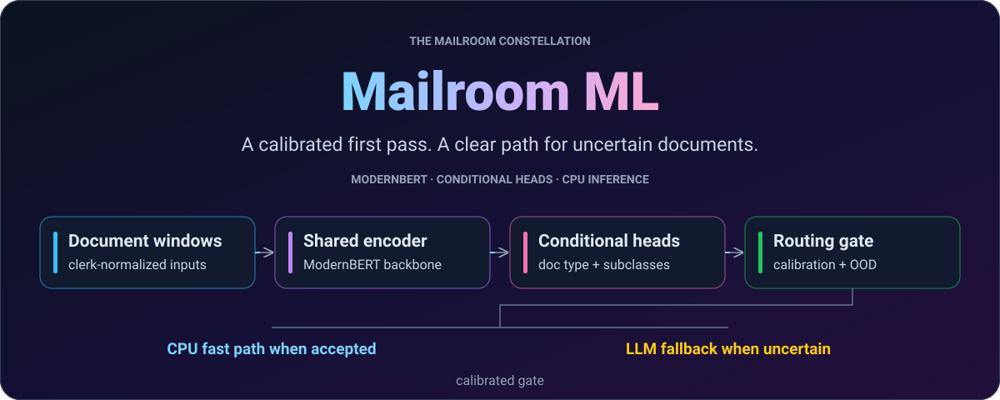

<div align="center">

<picture>
  <source media="(max-width: 640px)" srcset="docs/assets/readme/hero-mobile.svg"/>
  
</picture>

# Mailroom ML

[](pyproject.toml)
[](src/mailroom_ml/inference.py)
[](deploy/README.md)
[](pyproject.toml)

**[Quickstart](#quickstart)** · **[How it works](#how-it-works)** · **[Results](#evaluation-evidence)** · **[Workflows](#training-and-evaluation)** · **[Docs](#documentation)**

</div>

---

## What this does

Machine-learning training, evaluation, and deployment for the Digital Mailroom
**ModernBERT ingest fast-path classifier**: one shared encoder plus conditional
subclass heads, clerk-normalized inputs, per-head calibration, and a composite
routing gate. The LLM sorter remains the authority for the messy / ambiguous /
sparse tail.

This is a **standalone contractor repo** — not a governed constellation member.
It serves `eval-environment`, `llm-mailroom`, `Mailroom-Corpus-EDA`, and the
`mailroom-issues` epic **#85** intake-overhaul track. Canonical subclass
surfaces are consumed, never redefined here.


<div align="center">

</div>

## Prerequisites

- Python **3.11+**
- [uv](https://docs.astral.sh/uv/)
- Optional: Modal account + `HF_TOKEN` for cloud training
- Optional GPU for local train/eval

## Quickstart

<a id="quick-start"></a>

```bash
git clone https://github.com/LLM-Mailroom-Services/mailroom-ml.git
cd mailroom-ml
uv sync --extra dev
uv run pytest -m "not fullcorpus"
uv run ruff check src tests training deploy
```

The core suite is green with **no** modal / torch / onnxruntime installed.
Deploy-layer tests `importorskip` the heavy extras and never touch the network.

## How it works

<a id="architecture"></a>

- **Heads.** `doc_type` (5 classes) plus one subclass head per type
  (`contract`, `merger_agreement`, `corporate_record`, `correspondence`,
  `insurance_claim`). Head vocabularies are **derived from observed GT** at
  build time (`mailroom_ml.labels.observed_label_surfaces`), not hard-coded.
- **Windowing.** 8,192-token native context, 512-token overlap, plurality-vote
  merge. Default input construction is **v1** (`title + "\\n\\n" + body`) —
  byte-compatible with the published training revision. **v2** adds tagged
  `[FILE_NAME]` / `[TITLE]` / `[WINDOW_INDEX]` prefixes (`--input-construction v2`);
  never mix v2 windows into the v1 Hub pin.
- **Calibration.** Per-head temperature scaling. Eval can promote a
  selective-risk pick into `routing_thresholds.json` (`#25`); `load_bundle`
  overlays that file when present.
- **OOD.** Energy probe on doc_type logits (`ood_probe.json`, `#18`). Absent
  sidecar = probe absent (not a silent in-distribution claim). Flagged docs
  fail the fast path.
- **Routing.** `S = p_calibrated · agreement · margin` against the fast-path
  gate (`mailroom_ml.routing`). Catch-all `other` and unmapped subclasses
  route to the LLM.
- **Serving.** Primary path is ONNX on CPU (`artifacts/onnx/model/`), with **fp32 preferred**. Dynamic int8 quantization has known argmax disagreements; it is a fallback, not an equivalent certified bundle. The
  Modal serve app is an explicit **FALLBACK**.

## Evaluation evidence

The **M9c** model release is `m9c-20261014-113614` (recorded Hub commit
`0910ad7b`). These figures describe the **canonical held-out test, 323
documents**, from the committed [test report](reports/TEST-EVAL/TEST-EVAL-REPORT-m9c-20261014-113614.md)
and [evaluation JSON](reports/eval_m9c-20261014-113614.json).

| Metric | Result | Scope |
| :--- | ---: | :--- |
| Document-type accuracy | 0.9598 | 310 / 323 documents |
| Conditional subclass accuracy | 0.7387 | 229 / 310 scorable documents |
| Calibrated window ECE | 0.0189 | Window-level calibration |
| Confidence-gate acceptance (upper bound) | 0.3901 | 126 / 323; production guards not applied |

The confidence-only acceptance figure omits authentic-support, catch-all,
head-exclusion and subclass-projection guards. It is **not production fast-path
coverage**; the full routing gate can accept fewer documents.

The [#112 gate receipt](reports/TEST-EVAL/gates-check-armM9C.txt) passes the
specified contract/correspondence F1, document-type accuracy and window ECE
gates. Contract and correspondence remain excluded from fast-path routing by
the checkpoint policy. Gate success does not mean every subclass is reliable.
The separate [1,323-document distribution-shift evaluation](reports/eval_m9c-20261014-113614-heldout-plus.json)
is diagnostic evidence, not a larger certification set; see the
[correspondence probe](reports/PROBE-corr-unex-20261014.md).

## Configuration

### Environment extras

```bash
uv sync --extra dev      # pytest + ruff
uv sync --extra train    # torch / transformers / accelerate
uv sync --extra serve    # onnxruntime / optimum / fastapi
uv sync --extra deploy   # modal (deploy-time only)
```

Pins live in `pyproject.toml` + `uv.lock`. There is no parallel
`requirements/*.txt` tree.

## Hub pins (never live tips)

| Role | Repo | Revision (prefix) |
| --- | --- | --- |
| Canonical eval corpus | `Lucius-Morningstar/mailroom-dataset` | `ed7576b6…` |
| Working ML duplicate | `Lucius-Morningstar/mailroom-finetune` | `19720ceb…` |
| Prepared training set | `Lucius-Morningstar/mailroom-modernbert-training` | `5b72a345…` |
| Classifier publish target | `Lucius-Morningstar/mailroom-modernbert-classifier` | operator-set per run |

The current training revision is **leak-free and clerk-normalized**. Do not
reintroduce a title/filename label leak, and do not train on raw corpus text.
Authoritative constants: `src/mailroom_ml/config.py`.

## Training and evaluation

<a id="local-train--eval"></a>

```bash
# GPU local (only if you have one)
uv run python training/train/train_modernbert.py --help
uv run python training/train/train_modernbert.py \
  --data Lucius-Morningstar/mailroom-modernbert-training \
  --output artifacts/pytorch/model \
  --epochs 3 --select-on-subclass \
  --label-smoothing 0.05 \
  --subclass-label-smoothing 0.0 \
  --input-construction v1

# routing thresholds are fit on the validation (calibration) split — the eval
# refuses --write-routing-thresholds on any pool containing test docs (D11)
uv run python training/eval/eval_modernbert.py \
  --checkpoint artifacts/pytorch/model --subset validation --sample 0 --json \
  --write-routing-thresholds artifacts/pytorch/model/routing_thresholds.json
uv run python training/eval/eval_modernbert.py \
  --checkpoint artifacts/pytorch/model --sample 0 --json --selective-risk

# Paired bootstrap compare (classifier vs LLM sorter export, or two runs)
uv run python training/eval/compare_runs.py \
  --a reports/eval_m9c-20261014-113614.json --b reports/eval_b.json
```

`--label-smoothing` is **doc_type only**. Subclass CE uses
`--subclass-label-smoothing` (default `0.0`, `#22`). The trainer writes
`ood_probe.json` from **validation** logits (never the held-out test).

## Enrichment ladder

```bash
uv run python training/dataset/mailroom-dataset/fetch_corpus.py
uv run python training/train/preflight.py
uv run python training/dataset/mailroom-dataset/assemble_enrichment.py --tiers 1 --dry-run

# Tier-1 MAUD / S1 (#16): local path or repo@rev once a Hub pin exists
uv run python training/dataset/mailroom-dataset/assemble_enrichment.py --tiers 1 \
  --maud-pool path/to/maud.jsonl --s1-pool path/to/s1.jsonl --dry-run

# Tier-2 (#26): Enron blind pin is the default text pool; score first
uv run python training/eval/score_blind_pool.py \
  --pool data/enrichment/enron_blind.parquet \
  --checkpoint artifacts/pytorch/model \
  --out data/enrichment/blind_scored.parquet
uv run python training/dataset/mailroom-dataset/assemble_enrichment.py --tiers 2 \
  --blind-pool data/enrichment/blind_scored.parquet --dry-run

# Tier-3 (#28): seven gates are implemented (no stub cue checks)
uv run python training/dataset/mailroom-dataset/assemble_enrichment.py --tiers 3 \
  --tier3-cards cards.json --tier3-candidates candidates.jsonl --dry-run
```

Full publish sequence: [`docs/enrichment-publish-runbook.md`](docs/enrichment-publish-runbook.md).

`Lucius-Morningstar/mailroom-maud-contracts` and
`mailroom-s1-corporate-records` are **not published** as of 2026-09-26 —
empty `MAUD_REVISION` / `S1_REVISION` means "no default Hub fetch", never a
live tip.

## Modal training runbook (summary)

Full runbook + cost notes: [`deploy/README.md`](deploy/README.md).
Cloud training costs real money. Choose the GPU and run parameters from the
current [deploy runbook](deploy/README.md) and obtain a run-specific operator
budget before launching. The commands below are examples, not an active mission.

```bash
# one-time deploy (image cached; no GPU while idle)
HF_TOKEN=... uv run --extra deploy modal deploy deploy/modal_app.py

# cadence probe (minutes)
HF_TOKEN=... uv run --extra deploy python deploy/spawn_train.py --smoke

# real run — only after budget sign-off
HF_TOKEN=... uv run --extra deploy python deploy/spawn_train.py \
  --epochs 3 --budget 7 \
  --trainer-extra=--weight-mode=inverse \
  --trainer-extra=--weight-cap=20 \
  --trainer-extra=--loss-lambda-dt=0.65 \
  --trainer-extra=--label-smoothing=0.05
```

The normal **non-smoke** training chain (`#19`):

1. Exports ONNX via the committed `torch.onnx.export` path (`dynamo=False`).
2. Runs `onnx_parity_check.py --require-int8`.
3. Promotes `/checkpoints/latest` **only if** export + parity succeed.
   Failed parity leaves `latest/` on the last good checkpoint.

`--no-export-onnx` skips the chain. M9c initially failed the int8 gate and was
later promoted through the explicit **fp32-enforced, int8 report-only** relief
path documented in [the deploy runbook](deploy/README.md). A failed gate does
not authorize automatic promotion. Never use `optimum-cli export onnx` for
this multi-head architecture; use the committed export script.

## ONNX export (local)

```bash
uv sync --extra train --extra serve
uv run python deploy/onnx_export.py \
  --pytorch-dir artifacts/pytorch/model --out-dir artifacts/onnx/model
uv run python deploy/onnx_parity_check.py --require-int8
```

## Repository map

<a id="layout"></a>

| Path | Role |
| --- | --- |
| `src/mailroom_ml/` | Library (`config.py` is the interlock) |
| `src/mailroom_ml/ood.py` | Energy OOD probe (`#18`) |
| `training/` | Drivers: train, eval, enrichment, `compare_runs.py`, `score_blind_pool.py` |
| `deploy/` | Modal train/serve + ONNX export |
| `configs/` | Tracked policy YAML |
| `tests/` | Markers: `train`, `serve`, `fullcorpus` |
| `governance/` | `TASKS.md` board + `M9a-HANDOFF.md` |
| `docs/` | Combined plan + amendment + enrichment runbook |

Agent / contractor protocol: [`AGENTS.md`](AGENTS.md).

## Taxonomy law

Canonical subclass surfaces are sanctioned by mailroom-issues **#66/#67/#68**
and the dojo taxonomy (`DMR-066`). **mailroom-ml consumes the taxonomy; it
may not unilaterally redefine it.** Dictionary changes route upstream as an
RFC on the **#85** epic.

## Testing

```bash
uv run pytest -m "not fullcorpus"
uv run ruff check src tests training deploy
```

Core tests use injected bundles; model artifacts, training extras and corpus
snapshots gate their respective optional tests. See marker definitions in
[`pyproject.toml`](pyproject.toml).

## Documentation

<a id="governance"></a>

| Start here | Purpose |
| :--- | :--- |
| [Combined plan](docs/intake-classifier-combined-plan.md) | Architecture, data lineage and intake contract |
| [Deploy runbook](deploy/README.md) | Training, ONNX parity, promotion and serving |
| [Enrichment publishing](docs/enrichment-publish-runbook.md) | Staging, checks and explicit Hub publication |
| [Reports](reports/README.md) | Evaluation receipts and experiment history |
| [Mission board](governance/TASKS.md) | Current status; M9c release and remaining follow-ups |
| [Agent and contributor rules](AGENTS.md) | Taxonomy ownership, pins, tests and commit discipline |

The earlier [M9a handoff](governance/M9a-HANDOFF.md) is historical context;
the mission board records the later M9c release. New GPU work needs its own
operator budget authorization.

---

<div align="center">

**[Digital-Mailroom](https://github.com/LLM-Mailroom-Services/Digital-Mailroom)** ·
**[llm-mailroom](https://github.com/Exios66/llm-mailroom)** ·
**[llm-dojo-scoring](https://github.com/Exios66/llm-dojo-scoring)** ·
**[The-Mailroom](https://github.com/Exios66/The-Mailroom)** ·
**[local-mailroom-sandbox](https://github.com/Exios66/local-mailroom-sandbox)** ·
**[Mailroom-Corpus-EDA](https://github.com/Exios66/Mailroom-Corpus-EDA)** ·
**[mailroom-ml](https://github.com/LLM-Mailroom-Services/mailroom-ml)**

<sub>The Mailroom constellation · independent source repositories, shared interfaces.</sub>
<br/>
<sub>Core packages integrate in Digital-Mailroom; mailroom-ml is a standalone contractor.</sub>
<br/>
<sub>Local artwork: <a href="docs/assets/readme/README.md">design and regeneration</a>.</sub>

</div>
